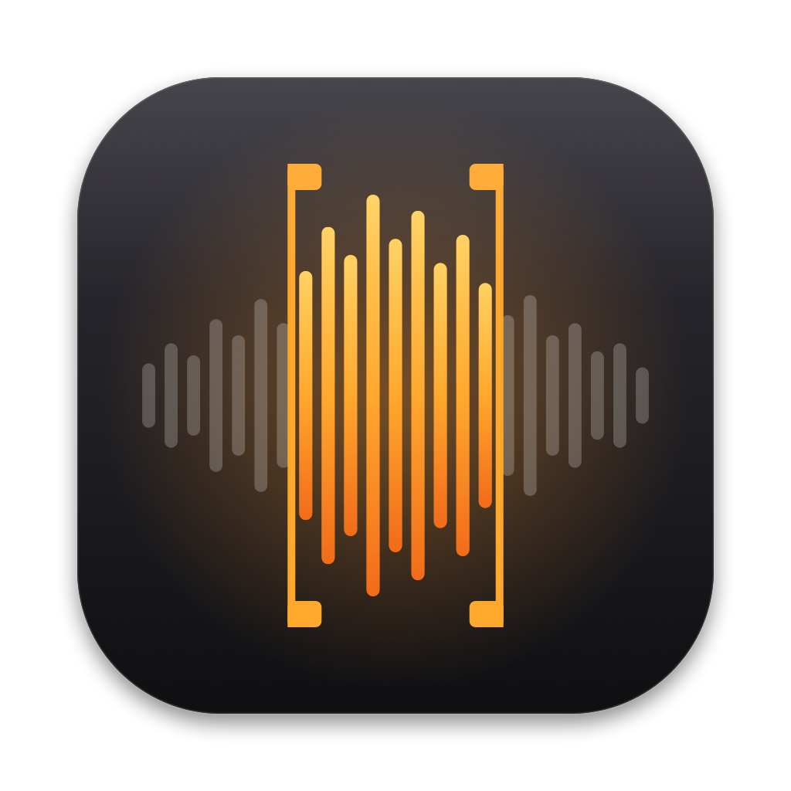

<p align="center"></p>

# Spotify Sampler

A native macOS sampler that records straight from the Spotify desktop app. Grab what just played, chop it across 16 pads, and play it from your keyboard or a MIDI controller. When you're done, drag the samples into your DAW.

It uses Core Audio **process taps** (macOS 14.4+), so it records Spotify only. Other system sounds stay out, Spotify keeps playing normally, and you don't need a loopback driver.

## Features

- **Always-on capture buffer:** it keeps the last 2 minutes. Press Return to grab the last 1–30 s, or record until you stop.
- **Grab in bars:** tempo and downbeat are tracked live, so you can grab the last 1/2/4/8 bars ending on the last downbeat (a clean loop, no trimming). The live view shows bar lines; nudge the downbeat a beat if it's off.
- **Works from any app:** ⌃⌥G grabs and ⌃⌥R starts/stops recording even while Spotify is in front.
- **16 pads:** keys `1-4 / Q-R / A-F / Z-V`, or MIDI notes from C1 (bottom-left pad) with velocity. Pads are one-shot or gate, with optional choke groups.
- **Auto-chop:** slice a region by transients (adjustable sensitivity), by beat or into 4/8/16 equal parts. Slices fill the empty pads and share the source audio.
- **Tempo:** BPM detection, a beat grid and beat snap. Pitch either varispeed (classic) or time-stretch (pitch and tempo independent). **Sync** stretches a pad to the project BPM.
- **Editor:** zoomable waveform, zero-crossing snap, loop and reverse, ADSR envelope, resonant low-pass and high-pass filters.
- **Stem separation:** splits a region into vocals, drums, bass and other on-device with [Demucs](https://github.com/facebookresearch/demucs). It downloads PyTorch and the model on first use, and nothing is uploaded.
- **Kits:** pads autosave to `~/Library/Application Support/SpotifySampler/Kits`. You can create, duplicate, switch and delete kits.
- **Export:** WAVs render exactly as they sound, with pitch, stretch, filter and envelope baked in. Save them to `~/Music/Spotify Sampler` or drag a pad into Finder, Logic or Ableton.

## Build

Requires macOS 14.4+ and Xcode 15+.

```bash
./build.sh        # builds, signs, installs to /Applications
swift test        # analysis / render / kit / MIDI tests
```

`build.sh` signs with your first `Apple Development` certificate, so macOS remembers the audio-capture permission across rebuilds. Override it with `SIGN_IDENTITY="…" ./build.sh`.

On first launch, allow **System Audio Recording** (System Settings › Privacy & Security › Screen & System Audio Recording). Also allow automation of Spotify, which the app uses only to label samples with the track name.

### Self-test

```bash
open -W /Applications/SpotifySampler.app --args --selftest /tmp/selftest.json
```

With Spotify playing, this captures 3 s, analyses and exports them, writes a JSON report and quits.

## Layout

| File | What |
| --- | --- |
| `SpotifyTap.swift` | Process tap + private aggregate device feeding the ring buffer |
| `RingBuffer.swift` | Lock-guarded 2-minute stereo history |
| `Analysis.swift` | Onsets, tempo + beat phase, zero crossings, waveform peaks |
| `Sample.swift` | `AudioSource` (shared audio) + `Sample` (per-pad params, envelope) |
| `SamplerEngine.swift` | AVAudioEngine voices, choke/release, offline render for export |
| `KitStore.swift` | Kit persistence |
| `MIDIInput.swift` | CoreMIDI (UMP) input, hot-plug |
| `StemSeparator.swift` | Demucs install + run in a private Python env |
| `AppModel.swift` | App state and glue |

## Note

This is a personal tool for practice and sketching ideas. Releasing music that uses the samples still needs clearance, and Spotify's terms don't allow redistributing its audio.
